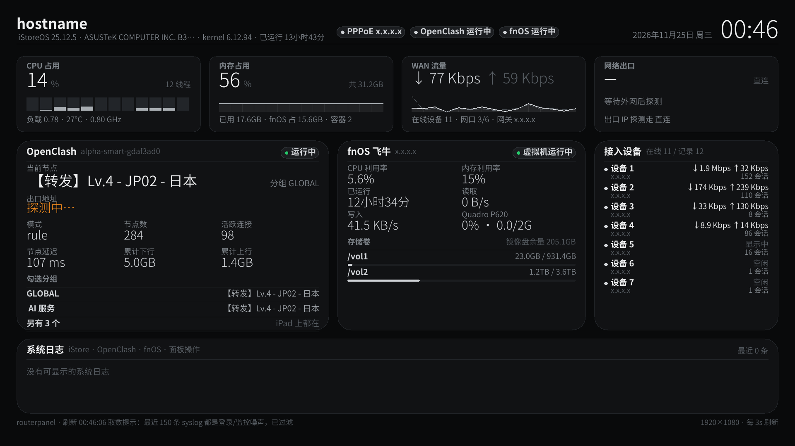
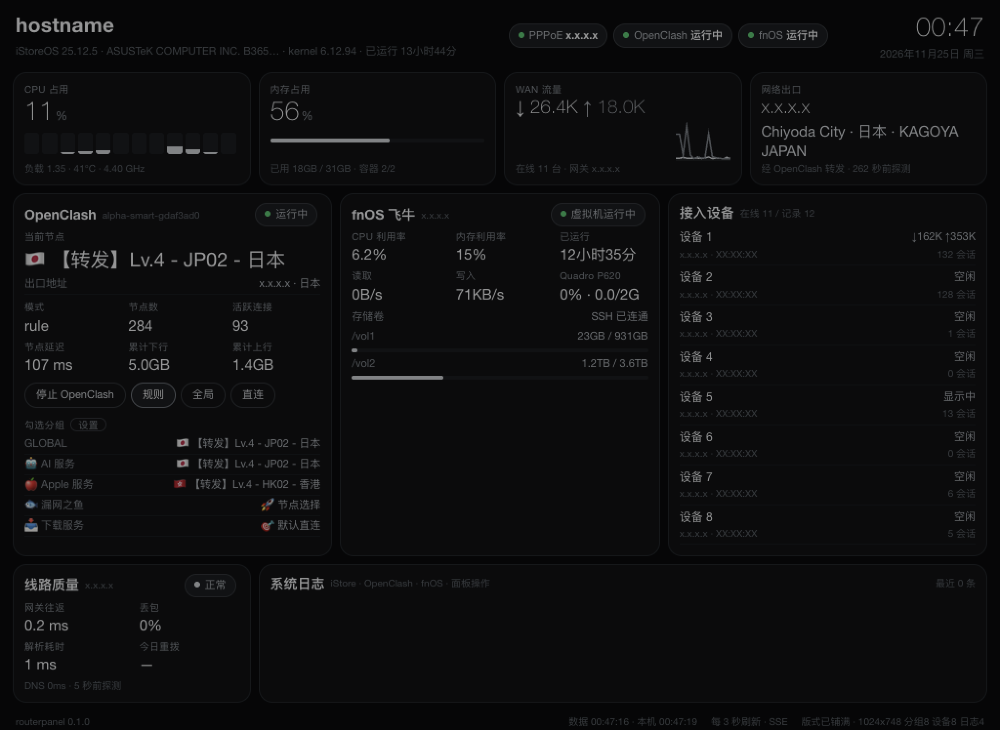
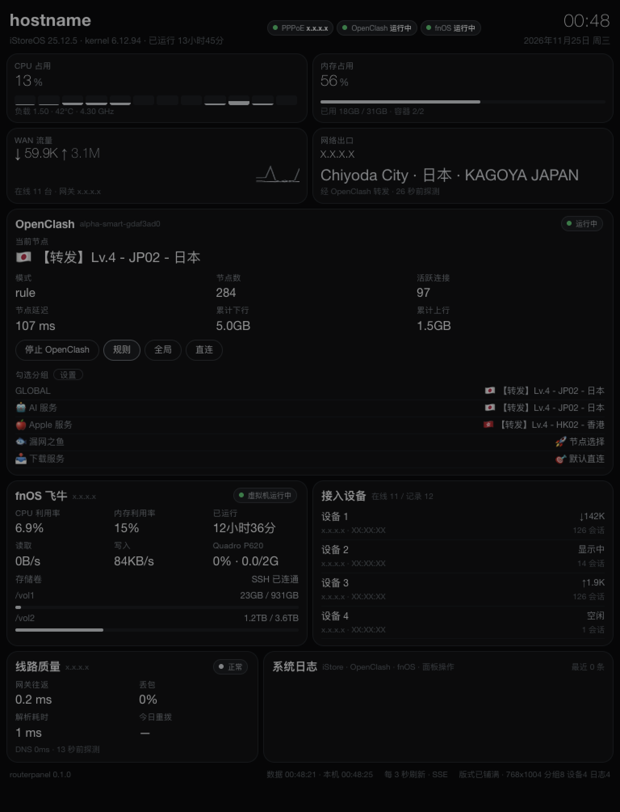

# Regisseur

给 x86 软路由做的**客厅状态屏** + **iPad 局域网网页**。一块接在路由器上的显示器（本项目用的是 DVI 1920×1080），
或者一台闲置 iPad，都能看到这台路由器现在到底在干什么：CPU/内存/流量、OpenClash 在走哪个节点、
旁挂的 NAS 虚拟机活没活、家里谁在联网、以及一份把 iStoreOS、OpenClash、fnOS、面板自己混在一起的日志。

本项目 fork 自 [linkease/lcdsimple](https://github.com/linkease/lcdsimple)——那是给 easepi-r1 / iStoreOS
做 LCD 状态屏的 C + LVGL 实现，思路（把路由器状态常驻画在一块小屏上）来自它。
这里的代码是**用 Go 从零重写的另一套实现**，不共享任何一行上游源码，原实现仍保留在
[`lcdsimple/`](lcdsimple/) 目录里。

## 截图

所有截图都是真机真数据，用 `-mask` 模式出的图：IP、MAC、主机名、设备名一律打码（见下面「截图模式」）。

| 屏幕端 1920×1080 | iPad 端 1024×748（横屏全屏网页） | iPad 端 768×1004（竖屏） |
| --- | --- | --- |
|  |  |  |

## 跑在什么机器上，吃多少资源

- **平台**：x86_64 + OpenWrt/iStoreOS（实测 iStoreOS 25.12.5，kernel 6.12.94）。
  需要一块能被 `fbcon` 接管的帧缓冲（32bpp）。树莓派那类 ARM 板子内的代码没有架构相关部分，
  交叉编译 `GOARCH=arm64` 就能跑，但没在真机上验证过。
- **常驻内存**：VmRSS ≈ **100 MB**。大头是画布本身（1920×1080 RGBA ≈ 8.3 MB）、
  帧缓冲差分包，以及中文字形缓存——面板上有几十个汉字在动，字形位图得留着。
- **CPU**：约**单核的 2.4%**（10 秒采样：24 jiffies / 100 Hz，一轮采集 3 秒）。
  进程被 procd 用 `nice 15` 降级，路由器再怎么跑也不会跟面板抢核。
- **体积**：单文件二进制 **9.4 MB**（`-ldflags="-s -w"`），无动态依赖，`CGO_ENABLED=0`。
- **线程**：18 个（HTTP、SSE、采集、SSH 各一组）。

## 功能

**屏幕端（帧缓冲直绘）**
- 顶栏：主机名 + 系统/内核/型号 + 运行时长，右侧三个状态气泡（拨号方式、OpenClash、NAS 虚拟机）。
  拨号气泡会真的识别联网模式——PPPoE / DHCP / 静态 IP / 旁路由，不会因为"不是 PPPoE"就报无连接。
- 四个 KPI 方块：CPU（每核柱状 + 温度/主频）、内存、WAN 流量（含折线）、网络出口（当前公网 IP 归属）。
- OpenClash 卡：当前节点、模式、节点数、活跃连接、延迟、上下行累计，以及**用户自己勾选要显示哪几个分组**。
- NAS 卡：虚拟机状态、客户机 CPU/内存利用率、读写吞吐、GPU（直通显卡的占用/显存/温度）、存储卷余量。
- 接入设备卡：谁在线、多少会话、各自上下行。
- 底部日志条：iStoreOS syslog、OpenClash、fnOS、面板自己的操作，混成一条带来源标签的时间线。

**iPad 端（局域网网页）**
- 同一份采集结果，同一套数据接口（SSE 推送，3 秒一跳），版式按视口自适应并自检是否铺满。
- 可选装成桌面图标：Safari「添加到主屏幕」，或描述文件（WebClip）方式。
- 开了 `control` 后可以在页面上切代理模式、启停 OpenClash、勾选分组；操作要令牌，且会写进日志条。

**两边共用**
- 关掉「屏幕输出」就真的退出显示：不写 `/dev/fb0`、把控制台还给系统、把上一帧刷黑，只留网页。
- PPPoE 账号密码这类东西**不会**出现在任何一屏上（面板只读接口状态，不读拨号凭据）。

## 安装

```bash
# 1. 编译（在任何一台开发机上交叉编译都行）
CGO_ENABLED=0 GOOS=linux GOARCH=amd64 go build -trimpath -ldflags="-s -w" -o routerpanel .

# 2. 铺文件
scp routerpanel root@<路由器>:/etc/routerpanel/routerpanel
scp files/init.d-routerpanel root@<路由器>:/etc/init.d/routerpanel
ssh root@<路由器> 'chmod +x /etc/init.d/routerpanel'
# uci 配置只在第一次铺，别覆盖用户后来改的值
scp files/routerpanel.uci root@<路由器>:/tmp/routerpanel.uci
ssh root@<路由器> '[ -f /etc/config/routerpanel ] || mv /tmp/routerpanel.uci /etc/config/routerpanel'

# 3. 字体（必须）：三个 glyf 轮廓的 TTF，CFF/OTF 不行——x/image 只吃 glyf
#    本项目用 Source Han Sans（SIL OFL）的 Light/Normal/Bold 三个字重
scp SHS-Light.ttf SHS-Normal.ttf SHS-Bold.ttf root@<路由器>:/etc/routerpanel/

# 4. 起服务
ssh root@<路由器> '/etc/init.d/routerpanel enable; /etc/init.d/routerpanel start'
```

装了 LuCI 的话，把 `files/luci/` 下三个文件放到 `/usr/lib/lua/luci/` 对应目录，
菜单里会出现「服务 → Regisseur 面板」，状态和开关都在那一页（改完记得清 `/tmp/luci-indexcache*`）。

仓库里的 `deploy.sh` / `shot.sh` 是开发用的循环：编译 → 推文件 → 重启 → 出一张图拉回来看。
它们不预置任何人的地址和密钥，用环境变量或同目录的 `.deploy.conf`（已被 gitignore）：

```bash
echo 'PANEL_HOST=root@192.0.2.1' > .deploy.conf
echo 'PANEL_KEY=$HOME/.ssh/id_ed25519' >> .deploy.conf
./deploy.sh build
```

## 配置

`/etc/config/routerpanel`（`option` 项与 LuCI 页面一一对应）：

| 项 | 说明 |
| --- | --- |
| `title` | 面板名字。屏幕顶栏、网页标题、iPad 桌面图标都用它。这是产品名不是机器事实，所以有默认值 |
| `enabled` | 总开关。0 就完全不启进程 |
| `screen` | 屏幕输出。0 = 不写帧缓冲、不占控制台，只留网页 |
| `interval` | 刷新秒数，默认 3 |
| `pixfmt` | 帧缓冲字节序，`bgra`/`rgba`。屏幕红蓝反了才改 |
| `http_port` | 网页端口，0/留空 = 不起网页。只监听局域网地址，不会监听拨号出口那侧 |
| `control` + `control_token` | 允许网页操作 + 令牌 |
| `fnos_host` / `fnos_user` / `fnos_key` / `fnos_mon` | 旁挂 NAS：地址、SSH 用户、只读私钥、qemu monitor socket |
| `ipad_host` / `ipad_user` / `ipad_key` | iPad 面板机（SSH 探活、看它在不在显示页面） |
| `groups_file` | 存「卡片上显示哪几个分组」，一行一个名字 |
| `proxy` | 测出口 IP 用的本地代理 |

**所有地址、用户名、密钥路径都留空当默认值**——空就是不探，界面上写「未配置」，
由用户自己填。代码里没有任何人环境里的现成值。

## 截图模式

```bash
routerpanel -mask -png /tmp/shot.png -warm 14
```

`-mask` 在数据层把这一帧里所有 IP、MAC、URL 主机名、主机名和设备名换掉，屏幕和网页两条输出都走同一份快照，
所以不会出现"截图里屏上打了码、页面上还挂着真实地址"。`-warm 14` 先空跑 14 轮让折线有历史。
端口（`:9090` 这类服务约定）会保留，只糊主机部分。

## 开发环境

- 写代码和出图在 macOS（Apple Silicon）上，`go build` 交叉编译到 `linux/amd64`，`deploy.sh` 推到路由器重启。
- 屏幕端不靠肉眼验收：`-png` 出图 → `tools/fb2png`、`tools/crop` 看图；要看真机就 `dd /dev/fb0` 再转 PNG。
  排版自检（文字行盒互相压住）在 `-png`/`-once` 模式下会直接把重叠报出来。
- iPad 端用 `?m=1` 让页面自己把每一排的高度量回来（这块屏不在手边，量一次要等一次部署，数字得自己带回来），
  再用 headless Chrome / 真浏览器按精确视口验证。
- `tools/` 下是排查用的小工具：`fnosh`（在路由器上用面板那把只读密钥连 NAS 跑一条命令——
  iStoreOS 自带的 dropbear 客户端连 fnOS 会 `Exited: String too long`，只能走 Go 的 x/crypto）、
  `ipadsh`（同一套路连 iPad，iOS 9 的 shell 里没有 `ls`/`base64`/`perl`，所以文件传输走 `printf '\NNN'` 八进制转义）、
  `metrics`（读自身 VmRSS/CPU，用来写上面那组数字）。

## 已知限制

- **iOS 9 的桌面图标（描述文件 WebClip）改不了状态栏颜色和启动图**。Apple 的 `com.apple.webClip.managed`
  只有 `Label/URL/Icon/FullScreen/IsRemovable` 这几个键，没有启动图；设备上的二进制取证也对得上：
  Web.app 里没有任何 WebClip 相关字符串，启动图是 SpringBoard 从 app bundle 里找的。
  要黑启动 + 黑状态栏 + 有图标，走 Safari「添加到主屏幕」这条路（页面已经带好
  `apple-touch-icon` / `apple-touch-startup-image` / `apple-mobile-web-app-status-bar-style`）。
- iPad 端为了 iOS 9 只能用 ES5 语法和 `-webkit-flex` 前缀，没有现代 CSS。
- NAS 那块卡的数据要靠 SSH 进客户机取；没配地址/用户就只显示宿主机侧能看到的。
- 直通显卡（本项目是 P620）的驱动状态随宿主内核变化，读不到时卡片会说明是哪一步失败，而不是显示 0。

## 许可

本项目代码 MIT（见 `LICENSE`）。上游 [lcdsimple](lcdsimple/) 保留在子目录里，版权归其原作者；
`lcdsimple/src/LICENSE` 是它自带的 LVGL 许可声明。字体用 Source Han Sans（SIL OFL），
需要自行获取，本仓库不打包。
